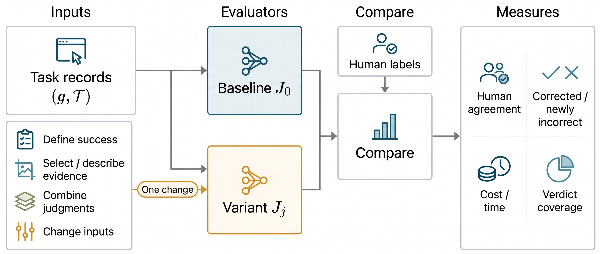

# Web Agent Evaluator Component Study

This project studies how changes to LLM evaluators affect their judgments of whether a web agent completed a user task. Instead of comparing complete evaluators as indivisible systems, we adapt principles from existing work to a shared AER-V baseline and examine their effects on the same recorded web-agent attempts.

A recorded attempt contains a user goal and a trajectory of browser states, actions and agent-generated text. The evaluator predicts task completion; its prediction is compared with the benchmark’s human judgment. Correct intermediate actions or a convincing completion statement are not sufficient by themselves to establish that the whole task was completed.

The framework compares the baseline judge with a variant, then measures agreement with human labels, errors corrected and newly introduced, cost and time, and verdict coverage. A component adaptation may change several inputs or calls together, so its result does not isolate every internal mechanism of the original published system.

## What is in this repository

This is the **prompt and input-construction companion** for the grouped experiments. It contains plain-text prompt files, explanatory READMEs, selected message-assembly snippets and an index of exact file hashes. It does not contain API credentials, model responses, expert labels, trajectory data, evaluation notebooks or the unpublished manuscript.

The numbering follows the supplied appendix, **Evaluator Prompts**, boxes 1–47. Each technique has its own folder and a navigation README. Original group IDs are retained: **Group 3 was dropped**, so there is no Group 3 experiment folder. There are four retained categories, labelled Groups 1, 2, 4 and 5.

## Navigate the prompts

| Group | Technique | Appendix boxes | Start here |
|---|---|---|---|
| Baseline | Vanilla AER-V | 1–3 | [Baseline](baseline/aer_v/) |
| 1 — Defining successful completion | Requirements checklist | 4–7 | [Checklist](group_1_defining_successful_completion/requirements_checklist/) |
| 1 | Independent expectations | 8–11 | [Expectations](group_1_defining_successful_completion/independent_expectations/) |
| 1 | Task-specific rules from AdaptRubric | 12–24 | [Rules and eight families](group_1_defining_successful_completion/task_specific_rules_adaptrubric/) |
| 2 — Selecting and organizing evidence | Screenshot selection from WebJudge | 25–31 | [Screenshot selection](group_2_selecting_and_organizing_evidence/screenshot_selection_webjudge/) |
| 2 | Step evidence from CRATE | 32–33 | [Step evidence](group_2_selecting_and_organizing_evidence/step_evidence_crate/) |
| 2 | Focused inspection from SeekJudge | 34–45 | [Focused inspection](group_2_selecting_and_organizing_evidence/focused_inspection_seekjudge/) |
| 4 — Combining judgments | Majority, conservative, strict unanimity | No LLM prompt | [Combination rules](group_4_combining_judgments/) |
| 5 — Changing input components | Without recorded reasoning | 46; reuses 1–2 | [Reasoning removal](group_5_changing_input_components/without_recorded_reasoning/) |
| 5 | Separate task reference images | 47; reuses 1–3 | [Task images](group_5_changing_input_components/task_reference_images/) |

### How to read and use a prompt file

1. Open the technique README. It identifies each call, its role, inputs, reused baseline files and expected output.
2. Read `.txt` files as message text or named fragments, using the **Role** column to distinguish system messages, user messages and additions. An addition is not a complete standalone prompt. Complete assembled judging system prompts are also supplied for checklist and expectations.
3. Fill `{intent}`, `{task}`, `{last_actions}` and other placeholders with the recorded values. Do not replace the original task with generated requirements or expectations. Expand the repeated step template in chronological order.
4. Send images as API image parts at the indicated positions. Lines such as `[IMAGE: final execution screenshot]` are documentation markers, **not literal text instructions**. Optional sections and repeated blocks must be expanded by the runner. Where multimodal serialization is schematic, the exact construction snippets are authoritative for the text parts and ordering.
5. Parse the specified final verdict field (`Status`, `Result` or `SCORE`) into **1 = judged successful** and **0 = judged unsuccessful**. These are task classes, not indicators that the evaluator was correct. Technical failures remain errors, not votes or task failures.

[`prompt_index.json`](prompt_index.json) records every prompt/component file’s role, appendix box number, source and SHA-256. Prompt files preserve archived source strings rather than copying broken PDF line wraps or glyph extraction artifacts. Prompt 39 includes the complete circled-image system prompt; the PDF prints only its opening. Recovery wording is separately labelled rather than silently replacing the original prompt.

## What each group tests

### Group 1 — Defining successful completion

- **Checklist:** extract explicit requirements from task text only, then supply the saved list separately to the baseline judge with one extra verification sentence. The extraction call sees no execution or task images.
- **Independent expectations:** describe how similar tasks are typically completed, before seeing execution actions, reasoning or later states. The generator sees the task, task reference images when present, and the first screenshot. The final judge treats the description as guidance, not evidence or extra requirements.
- **Task-specific rules:** route the task to a published family, generate up to two optional attention cues, and judge using the selected rules. The verifier receives the task, compiled answer/typed text/actions, recorded history and final screenshot. The cue generator’s recovery variant relaxes its word cap; completed earlier outputs can be reused.

### Group 2 — Selecting and organizing webpage evidence

- **WebJudge:** score all screenshots for relevance, keep qualifying frames and judge using the selected visual evidence. The corrected adapter keeps `send_msg_to_user` actions verbatim while leaving actor `action_thoughts` empty.
- **CRATE:** describe task-related screen clues and the literal action at each recorded step, then aggregate the descriptions and final screenshot. The first-stage screenshot is the action’s recorded **pre-action** state; a described effect is not an independently observed later outcome.
- **SeekJudge:** summarize adjacent state changes, ground actions, ask targeted questions about selected observations, then pass the resulting evidence packet to the baseline binary judge. The learned calibrator and controller sub-scores do not determine the binary verdict.

These adaptations change evidence access as well as prompting. They should not be described as prompt-only replications of full published evaluators.

### Group 4 — Combining saved judgments

Use the common trajectory identities with valid predictions from all seven judges: baseline plus the three Group 1 and three Group 2 variants. No new model calls are made.

| Rule | Decision |
|---|---|
| Majority | Success if at least four of seven say success; otherwise failure. |
| Conservative | Success only if all seven say success; otherwise failure. |
| Strict unanimity | Success if all say success; failure if all say failure; otherwise abstain. |

An error is never a vote. For strict unanimity, report coverage alongside metrics on covered trajectories; an abstention is not a failure prediction. Each subfolder has `decision_rule.txt` rather than an invented model prompt.

### Group 5 — Changing input components

- **Without recorded reasoning:** remove only the `Reasoning` line from each step. Preserve URLs, actions, answers inside actions, task text and final screenshot. No extra warning is added.
- **Task reference images:** preserve the complete baseline input and append separately labelled images supplied with the original task. Execution screenshots do not count as task reference images. In the frozen 500, 123 trajectories are VisualWebArena and 34 contain task reference images; the appendix’s comparison uses those 34. Expanded cohorts must have their own eligible identity lists.

## Experimental context

- **Benchmark:** AgentRewardBench, success judgment only; main component experiments use the frozen 500-trajectory test subset. A trajectory identity is the benchmark–agent–task tuple, not a task after collapsing different agents.
- **Dataset revision:** `b6d17e646009d6cb63d5dd7be78807b680693f61`.
- **Shared judge:** Together AI `MiniMaxAI/MiniMax-M3`, temperature 0, seed 0, evaluator reasoning mode requested off. The web agent’s recorded reasoning remains available unless a variant removes it. These are different channels.
- **Baseline input:** original task, chronological URL/action/reasoning history and final execution screenshot; task reference images are not separately attached.
- **Model comparison:** `Qwen/Qwen3.7-Plus` uses the unchanged baseline prompts. Full baseline evaluation covers 1,106 unique released test trajectories; the Qwen full run reuses its completed subset judgments. The grouped component study remains the frozen subset comparison.
- **Measures:** accuracy, precision, recall and F1 against human labels; paired corrections and introduced errors; exact McNemar tests where reported; model-token/cost/time measurements and coverage. Successful attempts are the positive class. Compare methods on the same eligible completed identities.

The repository does not make a claim that the included prompts guarantee correct verification. It releases the actual components and documents their input differences so that the comparisons can be understood and reproduced.

## Provenance

See [source references and attribution](THIRD_PARTY_NOTICES.md). The original papers and repositories motivate the components; the technique READMEs distinguish source wording, study additions and recovery variants. The provided manuscript is a draft, so this README uses a descriptive project title rather than its placeholder title or unfinished publication metadata.
